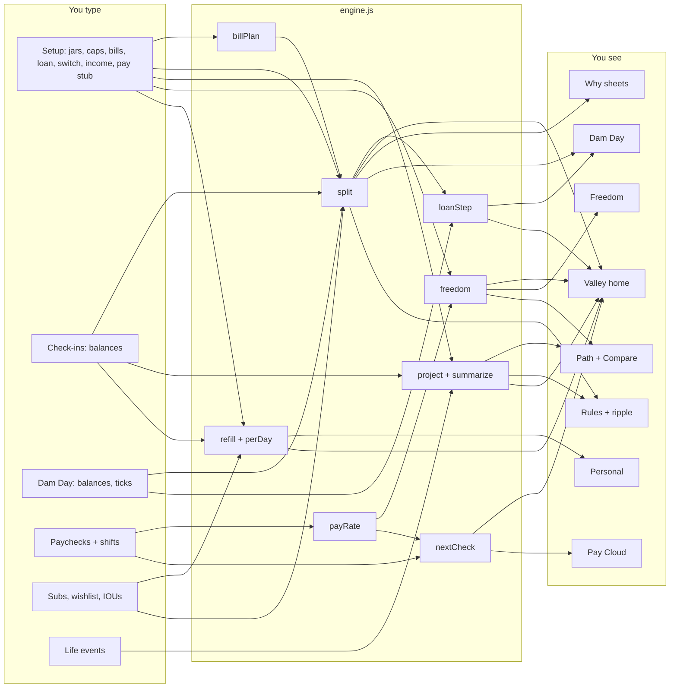

# Valley — the data map

Every number Valley needs, where it comes from, and what it feeds. The picture version is
`docs/valley-data.png`. The math lives in `valley/engine.js`; `valley/test.html` checks it.

**Valley in one line:** once a month the income account is split into jars, and the leftover
goes to the loan or the Roth first (your switch), then the other, then 75% investing / 25% fun.



---

## 1. What you type

Nothing personal lives in the code. The repo is public, so all of this is typed on the phone (or
imported from a backup file) and saved in the browser under `0_0-valley-v1`. The examples below are
made up (the same example `valley/test.html` uses).

### Setup — typed once, changed in Rules

| Data | Example | Feeds |
|---|---|---|
| Jar names + bank codes | Bills · S01 | every screen's labels |
| Bills cushion | $100 | `billPlan` (Bills never dips below it) |
| Gas cap, Misc cap, Vault cap | $500 · $800 · $5,000 | `split` (top-up targets) |
| Gas and Misc spend per month | $200 · $250 | `project`, `freedom` |
| Personal refill | $150 | `split`, `freedom`, `refill` |
| Bills: name + 12 monthly amounts | Car insurance: $600 in Jan and Jul | `billPlan` |
| The loan row in bills | "Car payment" (amount comes from the loan) | `billPlan`, `split` |
| Loan: owed, APR, payment | $12,000 · 7% · $350 | `split`, `loanStep`, `project` |
| Switch: what extra goes to first | the loan | `split` |
| Roth limit per year | $7,000 | `split` |
| Leftover split | 75% invest / 25% fun | `split` |
| Growth per year (assumption) | 5% | `project` |
| Expected income per month | $3,000 | `project`, fallback $/hr |
| Usual hours per week | 35 | `freedom`, `nextCheck` |
| Pay stub dates | paid Jan 15 for Dec 28 – Jan 10 | pay schedule (every 14 days, 5 days later) |
| Other money each month (optional) | $100 | lake estimate |
| Birth year (optional) | — | Path's "to 50" view |

### Logs — typed as life happens

| Data | When | Feeds |
|---|---|---|
| Balance check-in `{ date, jar, value }` | any time | latest balances → home, `project` start, fun money per day |
| Dam Day `{ month, income, before, owed, plan, done, after }` | the 1st | the transfer list; closing it steps the loan and logs the Roth |
| Paycheck `{ date, net, hours }` | payday | `payRate` ($/hr = last 3 checks) |
| Shift `{ date, hours }`, or the timer `{ start }` | after a shift | `nextCheck` |
| Subscription `{ name, amount }` | rarely | `refill` (comes out of Personal) |
| Wish `{ name, price, by, saved }` | when you want something | `refill` ($ a month to have it by then) |
| IOU `{ from, amount, date, paidIn }` | when you borrow from a jar | `split` (Personal pays it back first) |
| Life event `{ kind, start, end, amount, on }` | planning | `project` |

Life event kinds: **income** (take-home becomes `amount` from `start`, e.g. a new job),
**bills** (monthly bills change by `amount`, e.g. −$100 when insurance is covered), **once**
(one month's income changes, e.g. −$700 for a week off).

---

## 2. The math (`valley/engine.js`)

| Function | In | Out |
|---|---|---|
| `billPlan(bills, loan, cushion)` | 12-month bill table | `due[m]`, set-aside per month, `target[m]`, what each big bill has saved |
| `billsWhy(plan, m)` | the plan, a month | due items, saving-ahead per bill, cushion, target |
| `split(inp, settings)` | income, jar balances, loan owed, Roth used this year, IOUs | every transfer, shortfall, leftover, why |
| `loanStep(owed, apr, paid)` | loan, payment | new balance, interest |
| `payoff(owed, apr, payment, extra)` | loan | months to $0, interest |
| `payRate(paychecks)` | paychecks | $/hr from the last 3 |
| `stub`, `nextPayday`, `periodFor`, `nextCheck` | pay stub, shifts, $/hr | next payday, hours logged for it, estimate |
| `project(start, settings, { events })` | today's state | month-by-month future: transfers, balances, loan, Roth, investing |
| `summarize(rows)` | a projection | loan-free month, interest, Roth put in, invested value, money minus debt, milestones |
| `needs`, `freedom`, `hoursFor` | settings, $/hr | hours a week your life costs |
| `wishPlan`, `refill`, `perDay` | Personal, wishes | where each refill goes, fun money per day |

### The formulas

**Bills target** (what Bills should hold on the 1st of month *m*):
```
set-aside  = the year's bills ÷ 12
run[m]     = set-aside × (m + 1) − bills paid Jan..m
left[m]    = run[m] − lowest run of the year + cushion      ← Bills after m's bills are paid
target[m]  = left[m] + due[m]
```
The lowest point of the year lands exactly on the cushion, so Bills never runs dry before a big bill.

**The split**, in this order. A jar only gets money once every jar above it is full:
```
Bills     ← target − what Bills holds
Gas       ← cap − what Gas holds
Misc      ← cap − what Misc holds
Personal  ← refill − IOUs (borrowed money gets paid back out of fun money)
Vault     ← cap − what the Vault holds
leftover  = income − all of the above
switch = loan:  extra loan ← min(leftover, loan balance)   then Roth ← min(rest, Roth room)
switch = roth:  Roth ← min(leftover, Roth room)            then extra loan ← min(rest, loan balance)
then            invest ← rest × 75%,  fun ← rest × 25% (fun goes to Personal)
short     = what the jars needed − what they got (only when income runs out)
```

**The loan**, each month: `owed × (1 + APR ÷ 12) − payment − extra`. The last payment includes
that month's interest, so the loan really reaches $0 (the sheet leaves a few cents behind).

**$/hr** = (take-home of the last 3 checks) ÷ (their hours). Until you log a check:
expected income ÷ (hours a week × 4.33).

**Freedom meter** = (Bills set-aside + Gas spend + Misc spend + Personal refill) ÷ $/hr ÷ 4.33.

**Fun money per day** = Personal's latest balance ÷ days until the next Dam Day.

**A wish** costs (price − saved) ÷ refills left before its date, counting this month's.

### Between Dam Days (in `valley.js`, checked in `valley/test.html` too)

Dam Day always splits the balances you type. Before then, every screen shows an estimate:
```
lake      = income account at your last check-in
          + each payday after that check-in, up to Dam Day (or today, if Dam Day is late)
            at $/hr × usual hours × 2 weeks
          + other money, if that check-in was before Dam Day
jars      = latest balance, except right after a split (nothing typed since):
            Bills − that month's bills, Gas and Misc − their usual spend, Personal − its refill
```
So right after November's split, December's preview is the steady month (Bills ≈ the set-aside,
Gas and Misc ≈ their spend), not the full jars you just filled. Check in and the typed number wins.

**One more shift** (Pay Cloud) = the split run again with one 10-hour shift more (and less): it
shows exactly where that money lands, jars first if any are short.

**Start screen line** (`0_0-line-valley`, written whenever Valley saves or opens):
`{ split: '2026-11-01', kind: 'ok' | 'check' | 'dam', note, day }`. The start screen counts the days
to `split` itself, so an old line still reads right: "On track · Dam Day in 17 days", amber for a
heads-up or "Dam Day: time to split".

---

## 3. What you see

| Screen | Shows | From |
|---|---|---|
| Valley (home) | on track?, fun $/day, freedom, Dam Day countdown, cloud (next check), lake (income account), the four jars, loan HP, Roth, vault, next up | latest balances, `split` preview, `nextCheck`, `freedom`, `summarize` |
| Why sheets | the math behind each jar's number | `billsWhy`, `split` |
| Dam Day | type balances → transfer checklist → close; spent since last split; bank match | `split`, `loanStep` |
| Path | money minus debt over 1/5/10 years (or to 50), life events, milestones | `project`, `summarize` |
| Compare | your plan vs the flipped switch vs a what-if | `project`, `summarize`, `freedom` |
| Rules | every number above, with a ripple preview before you save | all of it, run twice |
| Pay Cloud | shift timer, hours for the next check, $/hr from your checks | `payRate`, `nextCheck` |
| Personal | fun money per day, where each refill goes, wishlist, IOUs | `refill`, `perDay` |
| Freedom | hours a week your life costs, and what lowers it | `freedom`, `hoursFor` |
| Start screen | one line: on track and days to Dam Day (amber for a heads-up or Dam Day) | `0_0-line-valley` |

## 4. Choices baked in (all visible in the app)

- **Roth room is per calendar year**, like the sheet. (The IRS lets you add to last year's Roth
  until April 15. Valley doesn't count that.)
- **Interest is monthly**, on what's owed on the 1st. Real loans charge daily, so expect the real
  payoff to land within a month of Valley's date.
- **Money minus debt** = jars + Roth + investing − loan. The car's value isn't counted.
- **Fun money gets spent** in projections, so only investing grows.
- **Growth is an assumption** (6% a year by default) and only touches investing and the Roth.
- **Nothing in the bank is touched.** Valley tells you which transfers to make; you make them.
- **Other money** (Rules → Income) is counted once a month, until you check in on Dam Day.
- **Between Dam Days the numbers are estimates** (see above). Dam Day itself only uses what you type.
